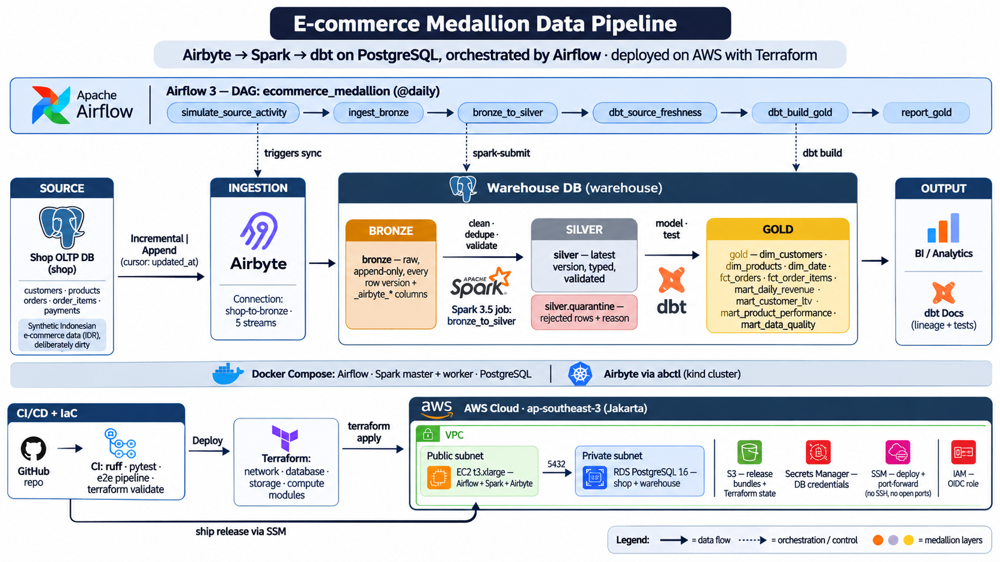
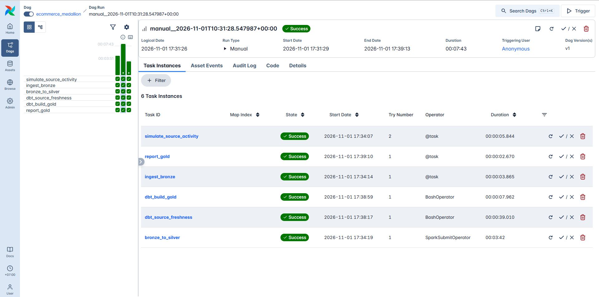
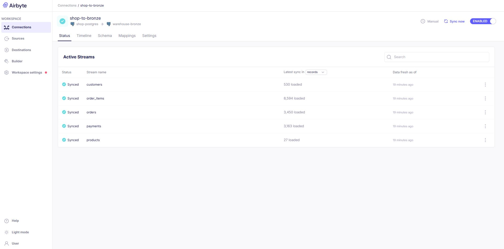
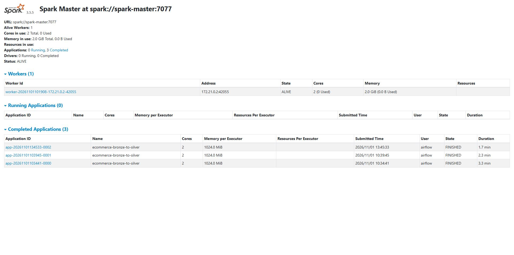
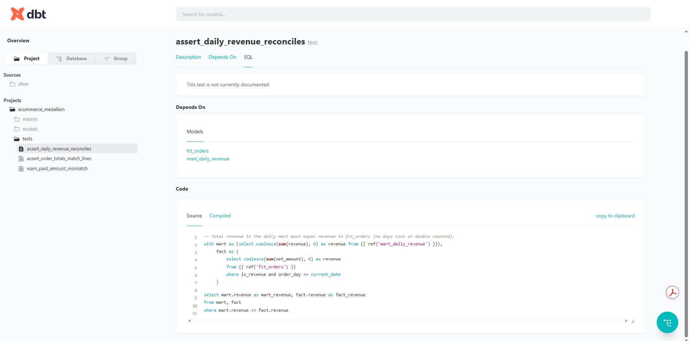

# E-commerce Medallion Pipeline

Batch data platform for a (fictional) Indonesian e-commerce shop, priced in IDR.
**Airbyte** ingests the shop's Postgres into **bronze**, **Spark** cleans it into **silver**, **dbt** models
**gold**, and **Airflow** orchestrates it daily. Everything lands in **PostgreSQL**.
It runs locally with Docker and deploys to **AWS** (EC2 + RDS + S3 + Secrets Manager), provisioned by
**Terraform** and shipped by **GitHub Actions**.



```
 shop (OLTP Postgres)                     warehouse (Postgres)
 ┌───────────────┐   Airbyte    ┌──────────────────┐   Spark    ┌──────────────────┐   dbt    ┌──────────────────┐
 │ customers     │  incremental │ bronze.*         │  clean +   │ silver.*         │  model + │ gold.dim_*       │
 │ products      │ ───────────► │ every version of │ ─────────► │ latest version,  │ ───────► │ gold.fct_*       │
 │ orders        │   append     │ every row, raw   │  validate  │ typed, validated │   test   │ gold.mart_*      │
 │ order_items   │  (updated_at │ + _airbyte_* cols│  + dedupe  │ silver.quarantine│          │                  │
 │ payments      │   cursor)    └──────────────────┘            └──────────────────┘          └──────────────────┘
 └───────────────┘
                     Airflow DAG `ecommerce_medallion` (@daily):
   simulate_source_activity → ingest_bronze → bronze_to_silver → dbt_source_freshness → dbt_build_gold → report_gold
```

## Tech stack

| Layer | Tool | Role |
|---|---|---|
| Ingestion | **Airbyte** OSS (via `abctl`) | `Incremental \| Append` sync, cursor `updated_at`, shop → `bronze` |
| Processing | **Apache Spark** 3.5.5 (standalone cluster) | `bronze` → `silver`: dedupe, normalise, validate, quarantine |
| Modeling | **dbt** 1.11 (dbt-postgres) | `silver` → `gold` dims, facts, marts + schema & reconciliation tests |
| Orchestration | **Apache Airflow** 3.2.1 | DAG `ecommerce_medallion`, daily or on demand |
| Storage | **PostgreSQL** 16 | `shop` (source) and `warehouse` (bronze / silver / gold schemas) |
| Infrastructure | **Terraform** (AWS provider ≥ 5.80) | VPC, EC2, RDS, S3, Secrets Manager, IAM, GitHub OIDC |
| CI/CD | **GitHub Actions** | lint, tests, end-to-end pipeline run, `terraform plan/apply`, deploy over SSM |

## The three layers

| Layer | Written by | What it holds |
|---|---|---|
| **bronze** | Airbyte (`Incremental \| Append`, cursor `updated_at`) | Raw source columns + `_airbyte_raw_id`, `_airbyte_extracted_at`, `_airbyte_meta`, `_airbyte_generation_id`. Append-only, so every change to a row is kept. |
| **silver** | Spark job `spark/jobs/bronze_to_silver.py` | Latest version per key, trimmed/normalised text, phone numbers as `+62…`, canonical order/payment vocabularies, typed money columns. Rows that break a rule go to `silver.quarantine` with the reason. |
| **gold** | dbt project `dbt/` | `dim_customers`, `dim_products`, `dim_date`, `fct_orders`, `fct_order_items`, and marts `mart_daily_revenue`, `mart_customer_ltv`, `mart_product_performance`, `mart_data_quality`. Tested with schema tests + reconciliation tests. |

The generator (`pipeline/generator.py`) deliberately produces dirty data so silver has real work:
messy casing/whitespace, three phone formats, ~2 % invalid emails, zero quantities, orphan order lines and
spelling variants (`CANCELED`, `E-Wallet`). Cleanable problems are fixed; anything that would make gold wrong
is quarantined. A bad email nulls the email (`email_is_valid = false`) but keeps the customer.

Silver rules (`spark/jobs/transforms.py`):

| Entity | Quarantined when |
|---|---|
| customers | missing id or first name |
| products | missing SKU, price ≤ 0 |
| orders | status not in the vocabulary, unknown/missing customer, order date in the future |
| order_items | quantity ≤ 0, negative price, discount < 0 or > line value, unknown order (orphan), unknown product |
| payments | unknown method or status, negative amount, unknown order |

Revenue rule (gold): an order counts as revenue when its status is `paid`, `shipped` or `delivered`.

## Screenshots

**Airflow:** DAG `ecommerce_medallion`, all six tasks green


**Airbyte:** connection `shop-to-bronze`, five streams synced incrementally into bronze


**Spark:** standalone master with the `ecommerce-bronze-to-silver` job runs


**dbt docs:** reconciliation test `assert_daily_revenue_reconciles` on the gold layer


---

## Run it locally

Needs Docker Desktop: ≈ 8 GB RAM for Airflow + Spark, and another ≈ 8 GB if you also run Airbyte.

```bash
cp .env.example .env              # set PG_PASSWORD and AIRFLOW_DB_PASSWORD
docker compose up -d --build      # postgres, db-init, spark-master, spark-worker, airflow
```

| UI | URL |
|---|---|
| Airflow | http://localhost:8080 (no login: bound to 127.0.0.1 only) |
| Spark master | http://localhost:8081 |
| Airbyte | http://localhost:8000 (when installed, see below) |
| Postgres | `localhost:5433` (user/password from `.env`) |

Postgres is published on **5433**, not 5432, so it doesn't collide with a natively installed Postgres.

The DAG `ecommerce_medallion` is unpaused and runs once right away. The first run seeds the shop with
500 customers and 3,000 orders; later runs add 150 new orders each (DAG param `simulate_orders`).
Trigger it again from the UI to see incremental loads flow through.

### Ingestion modes

`INGESTION_MODE` in `.env` picks who writes bronze. Both produce the **same table shape**, so silver and gold
are identical either way.

| Mode | Writer | Use it when |
|---|---|---|
| `airbyte` | Airbyte connection `shop-to-bronze` | the full production-style stack |
| `python` | `pipeline/bronze_loader.py` | low-RAM machines, CI, quick iteration |

Pick one mode per warehouse. To switch, drop the `bronze.*` tables first, then change `.env` and run
`docker compose up -d airflow`; the next run reloads bronze from the source.

### Setting up Airbyte (`INGESTION_MODE=airbyte`)

Airbyte OSS installs with `abctl` into its own kind cluster, separate from the compose stack:

```bash
curl -LsfS https://get.airbyte.com | bash -     # installs abctl (Windows: download the zip from
                                                # github.com/airbytehq/abctl/releases)
abctl local install --port 8000                 # 10-20 min the first time
abctl local credentials                         # copy Client-Id / Client-Secret into .env
abctl local credentials --password <new>        # optional: set your own UI password
# in .env: INGESTION_MODE=airbyte, AIRBYTE_CLIENT_ID=..., AIRBYTE_CLIENT_SECRET=...
python scripts/airbyte_bootstrap.py             # creates source, destination, connection (idempotent)
docker compose up -d airflow                    # pick up the new env
```

The bootstrap script creates:

| Object | Name | Settings |
|---|---|---|
| Source | `shop-postgres` | Postgres `shop`, schema `public`, standard (cursor) replication |
| Destination | `warehouse-bronze` | Postgres `warehouse`, schema `bronze` |
| Connection | `shop-to-bronze` | 5 streams, `Incremental \| Append` on `updated_at`, manual schedule (Airflow triggers it) |

Airbyte reaches Postgres through `host.docker.internal:5433`.

### dbt docs

```bash
docker compose exec airflow /home/airflow/dbt-venv/bin/dbt docs generate \
  --project-dir /opt/project/dbt --profiles-dir /opt/project/dbt --target-path /tmp/dbt/docs
docker compose cp airflow:/tmp/dbt/docs ./dbt-docs
python -m http.server 8085 --directory dbt-docs   # http://localhost:8085
```

### Tests

```bash
pip install -r requirements-dev.txt   # needs Java 11/17 for the Spark tests
ruff check . && pytest -q
cd dbt && dbt build --profiles-dir .  # against a warehouse that silver has been written to
```

---

## Deploy to AWS with Terraform

### Architecture

```
                         ┌─────────────────────────── AWS account (ap-southeast-3) ───────────────────────────┐
                         │  VPC 10.40.0.0/16  (2 AZs, no NAT gateway, no load balancer)                       │
 GitHub Actions          │                                                                                    │
 ┌────────────┐  OIDC    │   public subnets                          private subnets                          │
 │ ci         │ ───────► │  ┌──────────────────────────────┐        ┌──────────────────────────────┐          │
 │ deploy     │  IAM role│  │ EC2 t3.xlarge (AL2023, 60GB) │  5432  │ RDS PostgreSQL 16            │          │
 └─────┬──────┘          │  │  docker compose:             │ ─────► │  db.t3.micro, 20 GB gp3      │          │
       │                 │  │   Airflow + Spark            │        │  databases: shop, warehouse  │          │
       │ terraform apply │  │  abctl: Airbyte              │        └──────────────────────────────┘          │
       │                 │  │  SG: no inbound rules        │                                                  │
       │ git archive     │  └───────▲──────────────▲───────┘                                                  │
       ▼                 │          │ pull bundle  │ read DB credentials                                      │
 S3 artifacts bucket ────┼──────────┘              └── Secrets Manager (generated by Terraform)               │
 (releases/, versioned)  │                                                                                    │
                         │   SSM Session Manager: run `de-deploy`, port-forward the UIs (no SSH, no open ports)│
                         └────────────────────────────────────────────────────────────────────────────────────┘
 S3 tfstate bucket (versioned, encrypted, native lockfile)  ◄── Terraform remote state
```

### AWS services used

| Service | What it does here | Why this choice |
|---|---|---|
| **Amazon EC2** (`t3.xlarge`, Amazon Linux 2023, 60 GB gp3) | Runs Airflow + Spark via docker compose and Airbyte via abctl | One host runs the same compose file as local dev: cheapest option, no code changes |
| **Amazon RDS for PostgreSQL 16** (`db.t3.micro`, 20 → 40 GB gp3 autoscaling) | Holds `shop` and `warehouse` (bronze/silver/gold) | Managed backups, patching and storage; private subnets only, reachable only from the EC2 security group |
| **Amazon S3** | `…-artifacts-<account>`: versioned release bundles (with lifecycle expiry); `…-tfstate-<account>`: Terraform state | Durable and cheap; both buckets encrypted and block all public access |
| **AWS Secrets Manager** | DB master credentials, generated by Terraform (`random_password`) | No passwords in Git, tfvars or user data; the host reads them at deploy time |
| **AWS Systems Manager (SSM)** | Session Manager for shell access, `send-command` for deploys, port forwarding for the UIs | No SSH keys, no bastion, **zero inbound security-group rules** |
| **Amazon VPC** | 2 public + 2 private subnets across 2 AZs, internet gateway, route tables, security groups | RDS needs a multi-AZ subnet group; skipping the NAT gateway saves ~US$35+/month |
| **AWS IAM** | Instance role (S3 read, secret read, SSM core); GitHub OIDC provider + deploy role | Least-privilege; CI uses short-lived OIDC tokens, no long-lived access keys |

### Terraform layout

```
infra/
├── bootstrap/                 run once, local state: tfstate bucket + GitHub OIDC provider + deploy role
├── environments/dev/          the environment (remote state in the bootstrap bucket)
│   ├── main.tf                wires the modules together
│   ├── variables.tf           project, environment, region, vpc_cidr, instance_type, db_instance_class,
│   │                          db_deletion_protection, ingestion_mode
│   ├── terraform.tfvars.example
│   └── backend.hcl.example
└── modules/
    ├── network/               VPC, subnets, IGW, route tables
    ├── database/              RDS instance, subnet group, DB security group, Secrets Manager secret
    ├── storage/               artifacts bucket (versioning, encryption, lifecycle, public access block)
    └── compute/               EC2 host, IAM role/profile, app security group, user_data bootstrap
```

Key variables (`infra/environments/dev`):

| Variable | Default | Notes |
|---|---|---|
| `region` | `ap-southeast-3` (Jakarta) | |
| `instance_type` | `t3.xlarge` | `t3.large` is enough with `ingestion_mode = "python"` |
| `db_instance_class` | `db.t3.micro` | |
| `ingestion_mode` | `airbyte` | `python` skips the Airbyte install on the host |
| `db_deletion_protection` | `false` | turn on for anything beyond dev |
| `vpc_cidr` | `10.40.0.0/16` | |

Outputs: `instance_id`, `artifacts_bucket`, `rds_address`, `db_secret_arn`, `airflow_ui_tunnel`,
`airbyte_ui_tunnel`.

### One-time setup

```bash
# 1. state bucket + GitHub OIDC role (admin credentials, local state)
cd infra/bootstrap
terraform init && terraform apply -var="github_repository=<owner>/<repo>"
#    (set -var="create_github_oidc_provider=false" if the account already has the GitHub OIDC provider)

# 2. GitHub repository → Settings → Variables:
#    AWS_ROLE_ARN    = output github_actions_role_arn
#    AWS_REGION      = ap-southeast-3
#    TF_STATE_BUCKET = output state_bucket
#    and create an Environment named "dev" (add required reviewers to gate deploys)
```

After that, every push to `main` that passes `ci` runs `deploy`: `terraform apply`, then the release is
shipped to the host. The first deploy also installs Airbyte and takes ~25 minutes.

### Deploy by hand

```bash
cd infra/environments/dev
cp backend.hcl.example backend.hcl            # fill bucket = <state_bucket output>
cp terraform.tfvars.example terraform.tfvars  # optional overrides
terraform init -backend-config=backend.hcl
terraform plan
terraform apply

# ship the code to the host (git archive → S3 → SSM runs deploy/ec2/setup.sh as `de-deploy`)
scripts/deploy_via_ssm.sh "$(terraform output -raw artifacts_bucket)" "$(terraform output -raw instance_id)"
```

On the host, `deploy/ec2/setup.sh` unpacks the bundle, writes `.env` from Secrets Manager (pointing at the
RDS endpoint), installs Airbyte when `ingestion_mode = airbyte`, runs `airbyte_bootstrap.py` and
`docker compose up -d`.

### Reaching the UIs

Nothing is exposed to the internet. Use SSM port forwarding (needs the AWS CLI + Session Manager plugin):

```bash
$(terraform output -raw airflow_ui_tunnel)   # then http://localhost:8080
$(terraform output -raw airbyte_ui_tunnel)   # then http://localhost:8000
```

### CI/CD

| Workflow | When | What |
|---|---|---|
| `ci` | every PR and push | ruff + pytest (incl. Spark tests) · **end-to-end pipeline** on a throwaway Postgres: generator → bronze loader (2 incremental batches) → `spark-submit` → `dbt source freshness` + `dbt build` · `terraform fmt` + `validate` · `terraform plan` on PRs (when AWS is configured) |
| `deploy` | after `ci` succeeds on `main`, or manually | `terraform apply` (Terraform 1.14.8) → upload bundle to S3 → `de-deploy` on the host over SSM |

### Cost (estimate, ap-southeast-3, on-demand, 24/7)

| Item | ≈ US$/month |
|---|---|
| EC2 t3.xlarge + 60 GB gp3 | 150-170 |
| RDS db.t3.micro + 20 GB gp3 | 20-25 |
| S3, Secrets Manager, SSM | ~1 |
| NAT gateway / load balancer | 0 (none) |

Stop the EC2 and RDS instances when you're not using them, or set `ingestion_mode = "python"` with
`instance_type = "t3.large"` to roughly halve the host cost. These are estimates; check the AWS Pricing
Calculator. `terraform destroy` removes everything (in dev, RDS deletion protection is off and no final
snapshot is taken).

### Scaling up: managed AWS alternatives

The single-host design keeps cost low and mirrors local dev. When volume or uptime requirements grow, each
component maps to a managed AWS service:

| Component | Now | Managed alternative | Switch when |
|---|---|---|---|
| Orchestration | Airflow on EC2 | **Amazon MWAA** (Managed Workflows for Apache Airflow) | you need HA schedulers and no host to patch |
| Processing | Spark standalone on EC2 | **Amazon EMR Serverless** or **AWS Glue** (Spark jobs) | silver no longer fits on one host |
| Ingestion | Airbyte OSS on EC2 | **AWS DMS** (CDC from Postgres) or Airbyte Cloud | you need CDC or don't want to run Airbyte |
| Warehouse | RDS PostgreSQL | **Amazon Redshift Serverless**, or S3 + Iceberg + **Athena** | analytical queries outgrow a row store |
| Source DB | RDS (single-AZ) | RDS **Multi-AZ** / **Aurora PostgreSQL** | production uptime matters |
| Monitoring | Airflow UI, logs on host | **Amazon CloudWatch** (logs, alarms) + SNS alerts | someone has to be paged |

dbt works against Redshift (`dbt-redshift`) and Athena (`dbt-athena`), so the gold models carry over with
adapter-level changes only.

---

## Layout

```
airflow/dags/ecommerce_medallion.py   the DAG
pipeline/                             generator, python bronze loader, Airbyte API client
spark/jobs/                           bronze_to_silver.py (job) + transforms.py (rules)
dbt/                                  gold models, schema tests, reconciliation tests
sql/init/                             databases + bronze/silver/gold schemas + source tables (idempotent)
docker/                               Airflow image (Airflow 3.2.1 + Spark client + dbt venv), Spark image
infra/                                Terraform: bootstrap (state + OIDC), modules, environments/dev
deploy/ec2/setup.sh                   host-side deploy (env from Secrets Manager, Airbyte, compose up)
scripts/                              airbyte_bootstrap.py, deploy_via_ssm.sh
.github/workflows/                    ci.yml, deploy.yml
static/                               architecture diagram + screenshots for this README
```

## Project status

| Area | Status |
|---|---|
| Local stack (Airflow, Spark, Postgres) | ✅ running, full DAG green |
| Airbyte mode | ✅ end-to-end: shop = bronze = silver (+ quarantine) row counts reconcile |
| dbt | ✅ `dbt build` + tests pass, docs generate |
| Terraform | ✅ `terraform validate` (bootstrap + dev); ⏳ `plan`/`apply` not yet run against AWS |
| GitHub Actions | ⏳ not yet run |

## Known limits

* Silver is rebuilt in full every run (read all of bronze, overwrite silver). Fine at this size; for large
  volumes make it incremental on `_airbyte_extracted_at` and merge.
* The Airflow container uses `airflow standalone` with LocalExecutor (one container). For production split
  it into api-server/scheduler/dag-processor/triggerer services, or move to MWAA.
* Single EC2 host: no high availability. RDS is single-AZ in dev.
